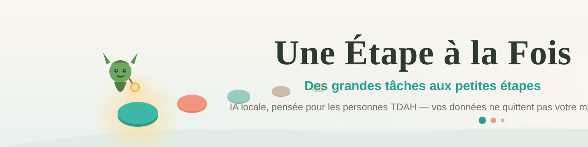

<div align="center">

# 🪨 Une Étape à la Fois



**Trop grand, trop flou, pas envie ? L'IA te montre juste la prochaine étape.**

Une application locale qui découpe les tâches en petites étapes faisables —
pensée pour les personnes **TDAH** et tous les cerveaux que les longues listes paralysent.
Un exe, un double-clic, et vos données ne quittent jamais votre ordinateur.


*Inspiré de [goblin.tools](https://goblin.tools) (outils de découpage de tâches pensés pour le TDAH
et la neurodiversité), réécrit en application 100 % locale avec l'aide d'un petit gobelin guide.* 🺺

</div>

---

## Pourquoi cette application ?

Si vous avez un TDAH, vous connaissez le phénomène : la tâche n'est pas difficile,
c'est **le premier pas** qui est infranchissable. « Organiser un anniversaire » n'est pas
une tâche, c'est un nuage. Cette application souffle sur le nuage et ne laisse flotter
que **la première pierre** — les suivantes resteront dans la brume jusqu'à ce que vous
ayez coché celle-ci.

Trois principes guident toute l'interface :

1. **Une seule étape en lumière.** L'étape en cours est mise en avant (jaune doux), le reste s'estompe.
2. **Zéro friction de démarrage.** Un exe, un double-clic, pas de compte, pas d'installation.
3. **Vos données chez vous.** Rien ne sort de la machine, sauf vers l'API du modèle que vous choisissez.

## ✨ Les 9 outils

| Outil | À quoi il sert |
|---|---|
| ☁️ **Le Nuage** <sub>· Magic ToDo</sub> | « Organiser un anniversaire » devient, en un clic, 3 à 8 petites étapes à faire tout de suite |
| 🏮 **La Lanterne** <sub>· Taskmaster</sub> | Une seule étape à l'écran, éclairée — on la coche, la suivante arrive. Contre l'angoisse de la liste |
| ✍️ **Le Traducteur** <sub>· Formalizer</sub> | Réécrit un texte parlé en 7 tons : amical, professionnel, excuses, enthousiaste… |
| 🪞 **Le Miroir** <sub>· Judge</sub> | Un message dont vous ne savez pas s'il sonne mal ? Il reflète les émotions implicites |
| 🎓 **Le Guide** <sub>· Professor</sub> | Du « comme à un enfant de 6 ans » au niveau expert : quatre profondeurs pour tout sujet |
| 🧭 **Le Carrefour** <sub>· Consultant</sub> | Quand vous hésitez : options, avantages et inconvénients, puis une recommandation |
| ⏳ **Le Sablier** <sub>· Estimator</sub> | On sous-estime toujours la durée — il détaille chaque sous-tâche, plutôt trop haut que trop bas |
| 🧺 **Le Rangeur** <sub>· Compiler</sub> | Met de l'ordre dans le brainstorm en vrac : une liste d'actions classées |
| 👨‍🍳 **Le Cuisinier** <sub>· Chef</sub> | Vous donnez les ingrédients sous la main, il propose des recettes sans courses en plus |

**Le Nuage et La Lanterne sont reliés** : le découpage se sauvegarde en liste, puis La Lanterne
avance étape par étape. Dissiper le nuage, puis avancer une pierre à la fois.

## 🚀 Démarrage

### Option 1 : télécharger l'exe (recommandé, rien à installer)

Rendez-vous dans [Releases](../../releases), téléchargez `UneEtapeALaFois.exe`
(un seul fichier, environ 16 Mo), **double-cliquez** — le service démarre en local
et le navigateur s'ouvre tout seul. Fermer la fenêtre de console arrête tout.

### Option 2 : lancer les sources

```bash
git clone https://github.com/Erik-42/une-etape-a-la-fois.git
cd une-etape-a-la-fois
# Windows : double-clic sur start.bat (les dépendances s'installent au premier lancement)
# À la main :
pip install -r requirements.txt
python run.py          # → http://127.0.0.1:8765
```

### Première utilisation : configurer le modèle (1 minute)

Ouvrez <http://127.0.0.1:8765> → ⚙️ en haut à droite → **Réglages** → renseignez une API
compatible OpenAI → « Tester la connexion » → c'est prêt.

| Fournisseur | URL de base | Modèle |
|---|---|---|
| DeepSeek | `https://api.deepseek.com/v1` | `deepseek-chat` |
| Qwen | `https://dashscope.aliyuncalc.com/compatible-mode/v1` | `qwen-plus` |
| Mistral | `https://api.mistral.ai/v1` | `mistral-small-latest` |
| OpenAI | `https://api.openai.com/v1` | `gpt-4o-mini` |

*N'importe quel serveur compatible OpenAI fonctionne — y compris un modèle tournant
sur votre propre machine (Ollama, LM Studio), pour un fonctionnement entièrement hors ligne.*

## 🔒 Confidentialité

- En dehors de l'API du modèle que **vous** configurez, l'application ne contacte aucun tiers :
  pas de statistiques, pas de traceur, pas de compte
- La configuration API est stockée sur la machine (fichier `goblin-settings.json`,
  dans le répertoire de données utilisateur) : elle survit aux réinstallations
- Historique et listes restent dans le navigateur (localStorage)
- Le répertoire de données est déplaçable via la variable `GOBLIN_DATA_DIR`
  ou le champ « Répertoire de données » des réglages
- Téléphone et ordinateur sur le même réseau : l'interface responsive s'ouvre
  depuis le navigateur du téléphone (IP de l'ordinateur, port 8765)

## 🎨 Design pensé TDAH

L'interface suit la même logique que le logo : **seule la première pierre est éclairée.**

| Couleur | Clair | Sombre | Rôle |
|---|---|---|---|
| 🟫 Fond nuit / Crème | `#F7F2E9` | `#221E17` | Fond principal (jamais de blanc pur ni de noir pur) |
| 🟩 Turquoise action | `#2A9D8F` | `#4FC3B2` | La seule couleur d'action : boutons, liens (éclaircie en sombre) |
| 🩵 Turquoise clair | `#6FD1C3` | `#6FD1C3` | Survol, validations |
| 🟠 Corail | `#E8806B` | `#F0967F` | Accents, focus clavier (chaud, jamais alarmant) |
| 🟡 Jaune doux | `#FFD98A` | `#FFD98A` | L'étape en cours — la lanterne du gobelin, identique sur les deux thèmes |
| ⬛ Texte | `#2F3B2A` | `#F2E9DA` | Texte principal (on inverse : le crème devient la couleur de texte) |
| 🟨 Cartes | `#E9F2EE` | `#2C271E` | Cartes et fond alterné, à peine distincts du fond |
| 🟧 Bordures | `#DCD2BC` | `#3A352C` | Discrètes dans les deux thèmes |

Règles d'or : **une seule** étape mise en avant à la fois, pas de rouge pour les erreurs
(on préfère le corail et un message explicite), fond **chaud** même en mode sombre
(les fonds gris-bleu fatiguent), et le mode sombre suit le système
(bouton lune/soleil, choix mémorisé).

## 🏗️ Stack et structure

Choix assumé : **zéro étape de build**. Trois paquets Python côté serveur,
aucun framework côté front.

```
une-etape-a-la-fois/
├─ UneEtapeALaFois.exe    # binaire PyInstaller (hors dépôt, voir Releases)
├─ run.py                 # entrée : serveur + navigateur + port suivant si 8765 est pris
├─ server/
│  ├─ main.py             # routes FastAPI + fichiers statiques
│  ├─ tools.py            # prompts des 9 outils et parsing JSON
│  ├─ llm.py              # client chat compatible OpenAI (httpx)
│  ├─ paths.py            # chemins source / exe
│  └─ settings_store.py   # lecture et écriture de la config
├─ web/                   # SPA HTML/CSS/JS (routage hash maison)
└─ test/mock_llm.py       # faux modèle : tests de bout en bout sans dépenser de crédit API
```

### Reconstruire l'exe

```bash
pip install pyinstaller
python -m PyInstaller --noconfirm --onefile --console --name UneEtapeALaFois \
  --add-data "web;web" --collect-all uvicorn run.py
# le binaire est dans dist/UneEtapeALaFois.exe
```

### Développement local

```bash
python -m uvicorn server.main:app --port 8765 --reload   # rechargement à chaque modification
python test/mock_llm.py                                   # faux modèle pour travailler hors ligne
```

## 🔖 Versionnage (SemVer)

Ce projet suit le **Versionnage Sémantique** : `MAJEUR.MINEUR.CORRECTIF` (`X.Y.Z`).
Voir [VERSIONING.md](VERSIONING.md) pour la politique détaillée.

## 🙏 Crédits

- [goblin.tools](https://goblin.tools) — l'application originale de découpage de tâches
  pensée pour le TDAH et la neurodiversité
- [lwjyzw/goblin-tools-local](https://github.com/lwjyzw/goblin-tools-local) — la version
  locale dont ce projet est le point de départ

## 📜 Licence

MIT — voir [LICENSE](LICENSE).

---

<div align="center">

**Le gobelin te tend la lanterne. La première pierre est là, juste devant.** 🺺✨

</div>