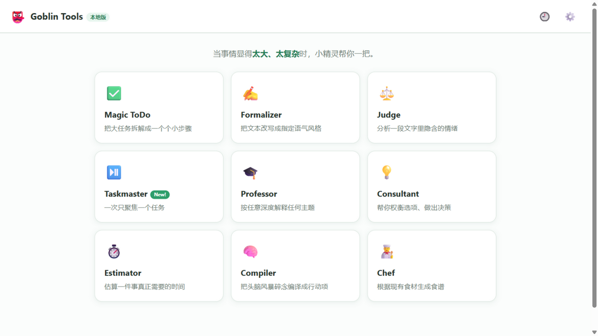
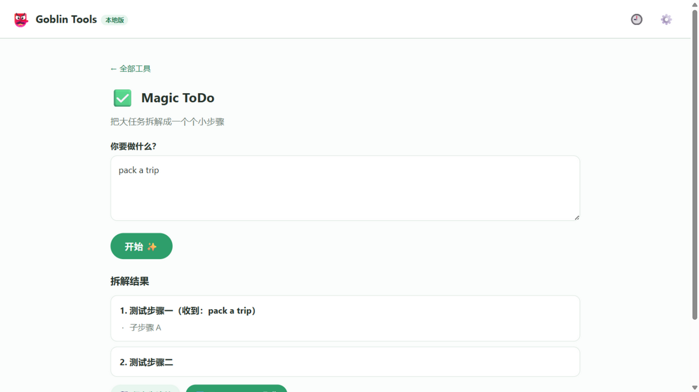
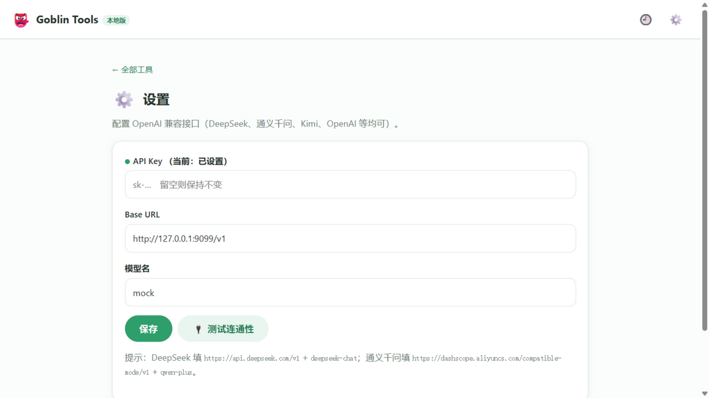

<div align="center">

# 👺 Goblin Tools — édition locale

**Quand ça paraît trop grand, trop compliqué, le gobelin te file un coup de main.**

L'IA découpe les tâches en petites étapes faisables — 9 outils du quotidien, tous en local, les données ne quittent pas ton ordinateur.


Inspiré de [goblin.tools](https://goblin.tools) (outils de découpage de tâches pensés pour le TDAH et la neurodiversité),
réécrit en application locale : un exe, ou trois paquets Python, suffisent pour tout lancer.

</div>

## Aperçu

| Accueil · les 9 outils d'un coup | Magic ToDo · des étapes à cocher | Réglages · n'importe quel modèle compatible OpenAI |
|---|---|---|
|  |  |  |

Un bouton lune / soleil dans la barre passe en mode sombre. Sans choix enregistré, le thème suit celui du système. Le choix est mémorisé dans le navigateur.

## ✨ Les outils

| Outil | À quoi il sert |
|---|---|
| ✅ **Magic ToDo** | Une grosse tâche du type « organiser un anniversaire » devient, en un clic, 3 à 8 petites étapes à faire tout de suite |
| ⏯️ **Taskmaster** | Une seule étape à l'écran — on coche, et la suivante arrive. Contre l'angoisse de la liste |
| ✍️ **Formalizer** | Réécrit un texte parlé en 7 tons : amical, professionnel, excuses, enthousiaste… |
| ⚖️ **Judge** | Un message dont tu n'es pas sûr du ton ? Colle-le, l'outil en sort les émotions implicites |
| 🎓 **Professor** | Du « comme à un enfant de 6 ans » au niveau expert, quatre profondeurs pour n'importe quel sujet |
| 💡 **Consultant** | Quand tu hésites : liste les options, avantages et inconvénients, puis une recommandation |
| ⏱️ **Estimator** | On sous-estime toujours la durée — il détaille chaque sous-tâche, plutôt trop haut que trop bas |
| 🧠 **Compiler** | « Compile » un brainstorm en vrac en une liste d'actions classées |
| 👨‍🍳 **Chef** | Tu donnes les ingrédients sous la main, il propose des recettes sans courses en plus |

ToDo et Taskmaster sont reliés : le découpage se sauvegarde en liste, puis le mode focus avance étape par étape.

## 🚀 Démarrage

### Option 1 : télécharger l'exe (recommandé, rien à installer)

Va dans [Releases](../../releases), télécharge `GoblinTools.exe` (environ 16 Mo, un seul fichier), **double-clique** —
le service démarre en local et le navigateur s'ouvre. Fermer la fenêtre de console arrête tout.

### Option 2 : lancer les sources

```bash
git clone https://github.com/lwjyzw/goblin-tools-local.git
cd goblin-tools-local
# Windows : double-clic sur start.bat (les dépendances s'installent au premier lancement)
# À la main :
pip install -r requirements.txt
python run.py          # → http://127.0.0.1:8765
```

### Première utilisation : configurer le modèle (1 minute)

Ouvre <http://127.0.0.1:8765> → ⚙️ en haut à droite → Réglages → renseigne une API compatible OpenAI →
clique sur « Tester la connexion » → c'est prêt.

| Fournisseur | URL de base | Nom du modèle |
|---|---|---|
| DeepSeek | `https://api.deepseek.com/v1` | `deepseek-chat` |
| Qwen | `https://dashscope.aliyuncs.com/compatible-mode/v1` | `qwen-plus` |
| Kimi | `https://api.moonshot.cn/v1` | `moonshot-v1-8k` |
| OpenAI | `https://api.openai.com/v1` | `gpt-4o-mini` |

## 🔒 Confidentialité

- En dehors de l'API de modèle que tu configures, l'application **ne contacte aucun tiers** — pas de statistiques, pas de traceur, pas de compte
- La configuration API est sur la machine (fichier `goblin-settings.json` à côté de l'exe) ; l'historique et les listes restent dans le localStorage du navigateur
- Le thème (clair ou sombre) est lui aussi stocké dans le navigateur
- Téléphone et ordinateur sur le même réseau : le navigateur du téléphone peut ouvrir l'IP de l'ordinateur sur le port 8765 (l'interface est responsive)

## 🏗️ Stack et structure

Choix assumé, zéro étape de build : **3 paquets Python côté serveur, aucun framework côté front**.

```
goblin-app/
├─ GoblinTools.exe        # binaire PyInstaller (hors dépôt, voir Releases)
├─ run.py                 # entrée : serveur + navigateur + port suivant si 8765 est pris
├─ server/
│  ├─ main.py             # routes FastAPI + fichiers statiques
│  ├─ tools.py            # prompts des 9 outils et parsing JSON
│  ├─ llm.py              # client chat compatible OpenAI (httpx)
│  ├─ paths.py            # chemins source / exe
│  └─ settings_store.py   # lecture et écriture de la config
├─ web/                   # SPA HTML/CSS/JS (routage hash maison)
└─ test/mock_llm.py       # faux modèle : tests de bout en bout sans dépenser de crédit API
```

### Reconstruire l'exe

```bash
pip install pyinstaller
python -m PyInstaller --noconfirm --onefile --console --name GoblinTools \
  --add-data "web;web" --collect-all uvicorn run.py
# le binaire est dans dist/GoblinTools.exe
```

### Développement local

```bash
python -m uvicorn server.main:app --port 8765 --reload   # rechargement à chaque modification
python test/mock_llm.py                                   # faux modèle pour travailler hors ligne
```

## 🙏 Remerciements

- [Goblin Tools](https://goblin.tools) — l'idée produit et la forme des outils
- FastAPI / uvicorn / httpx / PyInstaller — le chemin « projet Python → double-clic sur un exe » tient en 16 Mo

## 📄 Licence

[MIT](LICENSE)
